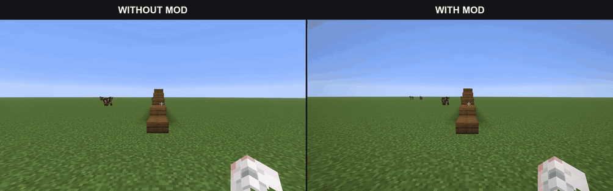

# Smooth Step Camera

Walk onto slabs and stairs with a smooth change in camera height.

Smooth Step Camera is a client-side Fabric mod for Minecraft Java 26.3. It smooths the half-block step onto a slab, the step from a slab to a full block, and short drops back down. Use it in first person, in either vanilla third-person view, or with Shoulder Surfing Reloaded.



## Camera behavior

The mod smooths height changes up to **0.6 blocks**. You keep the same player movement, collision box, and interaction reach.

Jumps and long falls do not trigger step smoothing. If you jump during a transition, the previous step's camera offset continues to fade out. Flying, swimming, climbing, and riding disable the effect.

## Shoulder Surfing Reloaded

The mod includes support for **Shoulder Surfing Reloaded 5.2.0** on Minecraft 26.3. The integration applies the camera height correction to Shoulder Surfing's wall checks as well.

Keep Shoulder Surfing's dependencies installed: **Fabric API** and **Forge Config API Port**. Loading checks cover Shoulder Surfing 5.2.0 with Fabric API 0.163.0+26.3 and Forge Config API Port 26.3.1.

## Configuration

After the first launch, open `config/smoothstepcamera.json`:

```json
{
  "enabled": true,
  "smoothingTimeMs": 180
}
```

| Setting | Default | Effect |
| --- | --- | --- |
| `enabled` | `true` | Turn step smoothing on or off. |
| `smoothingTimeMs` | `180` | Choose a transition time between 50 and 500 ms. |

Higher values give the camera a slower, softer transition. Restart the game after editing the file.

## Build from source

Use JDK 25. The project includes a Gradle wrapper.

Windows:

```powershell
.\gradlew.bat build
```

Linux and macOS:

```sh
sh ./gradlew build
```

The build runs the unit tests and writes the mod JAR to `build/libs`.

To check mixin loading through Fabric, run `runSmokeClient` with the same wrapper. The check exits before Minecraft opens a window. For a check with Shoulder Surfing, put its JAR and dependencies in `build/smoke/mods` first.

## License

[MIT](LICENSE).
